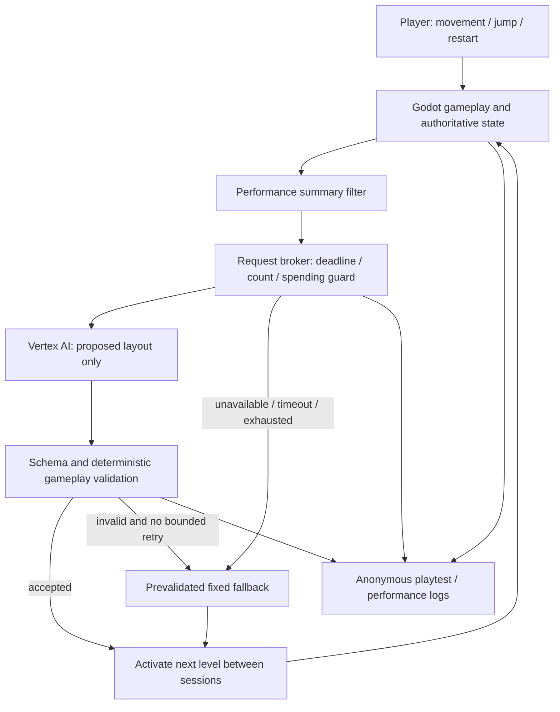

# Crown Chase — Initial Configuration Document

Status: **Initial / G1 proposal**, version 0.2, prepared November 16, 2026. This is a configuration plan, not an executable configuration or evidence of a working integration.

Accountable Owner: Scarlett Leon, Tech Lead, retaining Creative Director and Executive Producer approval. Gate Approver: instructor.

## 1. Authority, sources, and environment

Course requirements: local reader v2.1, Section 5.2, role coverage in Section 3.3, and G1–G3 playbooks. Design authority: Scarlett's 13-slide `docs/Crown_Chase.pdf`, particularly slides 8–11; the project brief adds Godot, token assumptions, and development-assistant categories. The local course reader remains excluded from Git. See [GDD](INITIAL_GDD.md) and [Project Plan](INITIAL_PROJECT_PLAN.md).

Repository inspection found a README and local references, with no tracked game implementation, agent configuration, test harness, or CI. All paths below are proposed future locations unless explicitly identified as one of these planning documents. Do not infer implementation from a proposed path.

**Proposed stack:** Godot for gameplay/rendering; Google Cloud Vertex AI for model requests; **Gemini 3.5 Flash-Lite is the proposed replacement** for the presentation's retired Gemini 2.5 Flash-Lite, supported by official availability documentation in Section 7. The replacement is not configured, tested, or approved; unresolved decisions remain [OPEN C2]. [OPEN C1] Godot version, scripting language, editor/toolchain, export targets, dependency versions, SDK/HTTP approach, and reproducible development setup are undecided. No installation or cloud provisioning is authorized by this document alone.

## 2. Architecture, world state, and player input



**Engine-owned world state:** Player position and movement state; health, lives, active power-ups; level geometry; enemies and their behavior state; obstacles; collisions/damage; completion/failure; attempt/session identifiers; baseline/adaptive condition. This is an initial conceptual state representation, not a schema. [OPEN C3] Concrete types, coordinate units, serialization, identifiers, and save/reset representation remain undecided.

**Player inputs:** Move left/right, jump, restart after failure. Stomping and collection emerge from world interactions. The agent receives no input-control tools. [OPEN D1/D5/D6] Bindings, device support, pause, health/life rules, and transition priorities need design decisions before coding.

**Boundary:** Only the engine commits state changes. Generation is an inter-session activity; active platforming never waits on a model. [OPEN D3] Define the session and transition unit before enforcing per-session budgets.

## 3. In-game agent contract

| Field | Proposed contract |
|---|---|
| Purpose | Suggest a level using predefined components and adapt challenge from bounded performance summaries. |
| Named context sources | Filtered deaths/retries/completion counters from gameplay; approved difficulty constraints; component catalog; movement constraints; output schema. Future paths: `config/level_components.json`, `config/difficulty_constraints.json`, `schemas/level.schema.json`. These files do not exist yet. |
| Knowledge boundary | No unrestricted live world state, credentials, repository access, raw participant identity, or private course references. Only allowlisted summary and constraint fields enter the request. |
| Tools and permissions | A bounded layout-proposal response; select allowed platforms, enemies, obstacles and permitted difficulty. No shell, file, network-browsing, or direct game mutation tools. Only the broker may call the configured provider. |
| Prohibited actions | Control the princess; alter movement, physics, damage or collision rules; add arbitrary executable code or assets; bypass validation; change budgets or its own configuration. |
| Memory | Proposed stateless request with a bounded recent-performance summary. [OPEN C5] History window, session reset, persistence, retention and deletion must be decided. No unrestricted cross-player or cross-session memory is proposed. |
| Model/settings | Proposed replacement Gemini 3.5 Flash-Lite (`gemini-3.5-flash-lite`) on Vertex AI; original Gemini 2.5 Flash-Lite retired. Not configured, tested, or approved. [OPEN C2] Approve model use and confirm project/region access, sampling settings, output-token cap, structured-output mode and any reasoning settings before live trials. |
| Output/recipient | A proposed layout to the deterministic validator; accepted data goes to the engine's level loader. Untrusted model output is never executed. |
| Evaluation | Deterministic contract/boundary/validator cases plus bounded live trials and adaptive-versus-fixed external playtesting. |
| Human override | Scarlett approves catalog, physics, constraints, prompts and model revisions; may disable live generation, force a reviewed fallback or baseline, or stop trials. A fallback run must be labeled honestly in evaluation. |

Proposed system-instruction draft, **not installed**:

> Propose one Crown Chase level layout using only the supplied schema, component catalog and difficulty bounds. Use only the supplied performance summary. Do not add code, assets, physics, collision or damage rules, or player commands. Return only the required layout data. Your proposal will be independently validated; inability to satisfy constraints must not widen your authority.

[OPEN C6] Final prompt, refusal representation, prompt/template versions, and structured response contract need approval and tests. Prompt instructions supplement engine enforcement; they do not establish safety or traversability by themselves.

## 4. Proposed generation data and deterministic validation

[OPEN C3] Candidate format: JSON with `schema_version`, `layout_id`, `difficulty_band`, bounded dimensions, `spawn`, `goal`, and arrays of component placements. Each placement would reference an allowlisted component ID and bounded coordinates; obstacle/enemy parameters would be allowlisted. This is a candidate field inventory, not a decided or validated schema. The model must not supply new physics or scripts. Source limits on player health/lives remain engine configuration.

[OPEN C4] Candidate pipeline, with algorithms and thresholds still to be selected:

1. Bound response size, parse and validate types, required fields, counts, numeric ranges and schema version; reject unknown authority-bearing fields.
2. Resolve all component IDs against the catalog; reject unknown assets, scripts, or unsupported variants.
3. Check geometry bounds, required goal, legal overlaps and a collision-free spawn with appropriate clearance from hazards/enemies.
4. Test a path from spawn to goal under the actual configured movement/collision rules, including relevant platform and hazard timing. Decide whether a deterministic simulation/search or a conservative movement graph is adequate. Document coverage limits; a rough jump-distance test alone cannot promise traversability.
5. Check difficulty constraints independently of reachability. Reject violations. Test the fallback under the same physics/configuration.

Movement tuning changes must invalidate or recheck affected generated layouts and fallbacks. Human playtests still assess fairness and enjoyment. No validation algorithm has been implemented or shown to pass.

## 5. Failure behavior, retries, and overrides

Required outcome: an invalid, unavailable, or late proposal never activates as a level. Use a predefined validated fallback when the deadline or limits prevent an acceptable layout. Baseline mode uses predetermined fixed levels without adaptation; fallback is a recovery mechanism in adaptive mode and must be recorded separately.

Proposed broker behavior for review:

- Start one total generation deadline at the transition; target 2–3 seconds and maximum wait 5 seconds. Include request, parsing, validation and any regeneration within that window; never reset the clock for a retry.
- Reject malformed, unsafe-spawn, out-of-bounds, untraversable or disallowed layouts. Retry only if both time and session count/spending capacity remain. [OPEN C7] Exact per-level regeneration count and network retry/backoff policy are undecided; no unbounded retry is allowed.
- On refusal, provider/auth/quota failure, timeout, validation failure without retry capacity, or exhausted budget, select a predefined fallback. Ignore a late response once a fallback or newer transition is committed.
- Before each request, reserve worst-case allowed token cost and include pending/uncertain charges. Count retries toward the proposed six-request maximum. [OPEN C7] Final spending reservation/accounting implementation and token caps must be established before claiming a hard monetary cap.
- Proposed edge-case safeguard: if a fallback fails validation or cannot load, stop that transition with a recoverable error and retain retry/menu access rather than start an unsafe level. [OPEN C4] Fallback catalog, selection rule, and recovery UI need approval.

Forced fallback is available to Scarlett for testing. It is not a replacement for demonstrating a working agent at G2 or for the agent-versus-baseline comparison.

## 6. Vertex AI integration and dependencies

Proposed integration sequence: confirm a supported model and region; choose private authentication; implement a bounded request interface; send only filtered context; enforce deadline/count/spending guards; validate returned data; load only accepted or fallback data; capture sanitized evidence. Begin with mocks and deterministic fixtures, then run capped live trials after approval of the configuration.

[OPEN C8] Choose a trusted broker/backend versus a private local-development adapter, hosting, request authentication and quota controls. Public client builds must not contain reusable cloud credentials or service-account keys. Use private external configuration/managed credentials; do not put credentials in prompts, logs, public artifacts, or source control. No cloud access, keys, endpoint or billing setup has been verified.

Dependencies include Godot/export tooling, the chosen language/runtime, Vertex AI model availability and quotas, a cloud project with appropriate IAM/billing, the JSON/schema implementation if chosen, component assets with approved provenance, fixed/fallback level fixtures, and a test/logging pipeline. [OPEN C1/C8/R1] Versions, packages, deployment costs and any reuse terms remain to be selected. No third-party code/assets are copied or licensed by these documents.

## 7. Model availability, latency, and cost budgets

Original G1 presentation proposal (slide 11), all unvalidated; historical model and cost assumptions are preserved below, separately from the proposed replacement:

| Item | Proposal |
|---|---|
| Provider/model | Google Cloud Vertex AI / Gemini 2.5 Flash-Lite (original slide choice; now retired) |
| Latency | 2–3 seconds target per generated level; 5-second maximum wait, then predefined fallback |
| Timing | Generate between gameplay sessions, never during active platforming |
| Model spending | Less than $0.01 target per player session; $0.05 maximum |
| Requests | Slide estimates 6/session; brief proposes a maximum of 6 including retries |
| Preliminary cost | $0.0036/session using original Gemini 2.5 Flash-Lite assumptions; not a verified Gemini 3.5 Flash-Lite estimate |

Brief's calculation: `(2,000 × $0.10 / 1,000,000) + (1,000 × $0.40 / 1,000,000) = $0.0006/request`; six requests total `$0.0036`. It excludes infrastructure and assumes those token totals cover all billed input/output. Track actual usage, retries, and any billed reasoning tokens; these assumptions do not prove compliance.

**Lifecycle and availability verified November 16, 2026:** Google's [official model lifecycle table](https://docs.cloud.google.com/gemini-enterprise-agent-platform/models/model-versions) lists `gemini-2.5-flash-lite` retirement as October 20, 2026, and lists `gemini-3.5-flash-lite` among generally available models, with retirement July 21, 2027 or later. It also names the latter as a replacement. Google Cloud Vertex AI remains the proposed platform; **Gemini 3.5 Flash-Lite is now the proposed replacement**, not configured, tested, or approved. [OPEN C2] Scarlett must approve its use and confirm project/region access and model settings before live trials.

**Revised replacement-model estimate — not measured:** The [official Google Cloud pricing page](https://cloud.google.com/model-garden/pricing), checked November 16, 2026, lists standard global Gemini 3.5 Flash-Lite rates of **$0.30/million input tokens** and **$2.50/million output tokens** (response and reasoning). With the same 2,000 input tokens, 1,000 total billed output tokens, and six requests: `(2,000 × $0.30 / 1,000,000) + (1,000 × $2.50 / 1,000,000) = $0.0031/request`; six requests total **$0.0186/session**. This assumes uncached text, standard global service, and no additional billed tokens or infrastructure costs; it is not a quote for every region/service tier.

This revised estimate is above the unchanged **less-than-$0.01 target** and below the **$0.05 maximum**. The original **$0.0036** remains a historical G1 estimate only. [OPEN C2] Review model configuration and token/request assumptions to address the target gap; project-specific access, actual usage and latency remain unverified. No budget or latency target has been validated, and no paid live requests were made. Preserve the **5-second maximum wait and predefined fallback** regardless of model choice.

## 8. Production assistants and role coverage

These assistants help develop the game; they are distinct from the in-game layout agent. No executable assistants or independent agent team were found/configured. Shared models may cover several responsibilities, but titles alone do not establish executable role coverage.

**Common proposed policy:** Context is the approved current GDD/configuration/plan and only relevant repository files. Memory consists of reviewed artifacts and bounded task/handoff records, not private playtester identity or secrets. [OPEN C5/C6/C9] Select each assistant's model/settings, prompt, memory retention and native executable configuration. Tools are limited to the task's proposed permissions below. Scarlett owns every deliverable, reviews decisions/code/results and integrates accepted work. Assistants may prepare local drafts; publishing, merges, cloud changes, asset reuse and spending require the applicable human authorization. No assistant may self-approve a gate or invent evidence.

All artifact paths in the table are **proposed, absent**. Each proposed role configuration must encode this common policy plus its own row's fields. Publishing a runnable extension with the syllabus-required common manifest is still required; this planning table does not fulfill that requirement.

| Role / requested assistant coverage | Proposed executable artifact | Purpose and named context | Tools/permissions | Output → recipient / handoff | Evaluation and human approval |
|---|---|---|---|---|---|
| Producer | `agents/producer/SKILL.md` | Scope, dependencies, capacity and risks; Plan and reviewed gate decisions | Read relevant repo; draft plan/PPP; Asana access only if authorized | Prioritized tasks, risk updates and evidence index → Scarlett and role assistants, with dependencies and acceptance criteria | Check estimates/dependencies and trace evidence; Scarlett approves commitments; instructor approves gates |
| Design Lead / Game Design and Documentation | `agents/design/SKILL.md` | Gameplay rules and document consistency; GDD, proposal decisions, anonymous observations | Read relevant design/code; draft specifications | Rule/design changes and test questions → Scarlett, Tech Lead and QA, with edge cases | Match pillars/scope and resolve contradictions visibly; Scarlett accepts creative decisions |
| Tech Lead / Gameplay Programming | `agents/gameplay/SKILL.md` | Movement, enemies, collision and builds; approved GDD, physics config and relevant source | Local code edits/build/test within assigned scope; no credentials or publication | Reviewed implementation/build instructions → Scarlett and QA, with runnable cases | Gameplay invariants and reproducible build; Scarlett reviews and integrates |
| Tech Lead / AI Integration | `agents/ai-integration/SKILL.md` | Bounded Vertex generation; Configuration, catalog/schema and provider docs | Edit adapter/schema and mocks; live API only under approved credentials/budget | Adapter, contract and sanitized traces → Scarlett and QA | Boundary, timeout, retry and spending checks; Scarlett approves model/cloud/config changes |
| Art Lead | `agents/art/SKILL.md` | Readability and feasible asset pipeline; GDD, catalog and provenance records | Draft style/readability specifications; no unapproved asset reuse | Visual specification and proposed assets → Scarlett and Tech Lead, with provenance | Readability/accessibility review and license check; Scarlett approves style/assets |
| Narrative | `agents/narrative/SKILL.md` | Minimal princess/crown/witch framing; approved GDD | Draft bounded text; no scope expansion | Minimal story/UI copy → Scarlett and Design Lead, with placement guidance | Story consistency and one-world scope; Scarlett accepts writing |
| Audio | `agents/audio/SKILL.md` | Minimum action/damage/reward cues; GDD and approved events | Draft cue plan; no unapproved licensed audio | Cue/event map and provenance → Scarlett and Tech Lead | Cue clarity, usability and rights check; Scarlett approves audio |
| QA / Testing and Validation | `agents/qa/SKILL.md` | Gameplay and generated-level tests; GDD, contract, build and fixtures | Local harness/tests; forced failures; capped live tests only if authorized | Reproduction cases, independent checks and failures → Scarlett and Tech Lead, with build/config IDs | Rules, traversability limits and fallback verified with evidence; Scarlett accepts fixes, not agent self-certification |
| BI / Evaluation and Analysis | `agents/evaluation/SKILL.md` | Player/performance evidence; approved protocol and anonymous logs | Analyze sanitized data; no invented results or participant contact | Metrics, observations and limitations → Scarlett, Design Lead and Producer | Reproducible metrics and human review of interpretations; Scarlett evaluates findings |
| Publishing and Release | `agents/release/SKILL.md` | Accessible runnable build/archive; approved build, rights and QA evidence | Prepare packaging/instructions locally; no upload, commit, push or release without authorization | Package checklist and run instructions → Scarlett and playtest/release reviewer | Another person can run identified build; Scarlett accepts package, instructor approves Gold |

Example proposed handoff: Design specifies an enemy's stomp/damage rules and acceptance cases; Gameplay returns a build and implementation notes; QA reproduces edge cases independently; Scarlett decides whether to integrate; Producer records effects on scope. The AI integration handoff includes schema/config versions, rejected outputs, forced-timeout and budget-exhaustion evidence, not just a successful API response.

## 9. Executable extension, versioning, tests, and CI

[OPEN C9] At least one agent must ship as a runnable extension artifact (skill/plugin/tool bundle/MCP/function interface or equivalent). Candidate: the Gameplay or QA skill with a common manifest pointing to its native executable files. Choose the artifact and create it in a later implementation task. Obtain the syllabus's exact required manifest fields; the reader references them but does not enumerate them. Do not claim a guessed manifest meets the syllabus.

Proposed version scheme: this document v0.2; independently identify prompt, schema, catalog, movement configuration, agent manifest and model/settings versions. Log these with build identifiers. Preserve approved versions; revise GDD/configuration at G2/G3 and finalize the implemented configuration at G4.

[OPEN C10] Proposed future harness entry points: `tests/run_gameplay.gd`, `tests/run_level_validation.gd`, and `tests/run_agent_contract.gd`; proposed CI path `.github/workflows/ci.yml`. If these Godot SceneTree scripts are adopted, candidate commands are:

```sh
godot --headless --path . --script tests/run_gameplay.gd
godot --headless --path . --script tests/run_level_validation.gd
godot --headless --path . --script tests/run_agent_contract.gd
```

These commands are **not runnable now**: neither `project.godot` nor these scripts exist. Finalize commands after choosing language/test runner. CI should run deterministic tests without cloud credentials; bounded live evaluations should be separately authorized. Cases include valid/invalid schema, unknown component, unsafe spawn, impossible route, moving-hazard constraints, forbidden state change, timeout, provider failure, malformed/refused output, retry/count/spending exhaustion, late response and invalid fallback. Also test baseline nonadaptation, damage/power-up/life transitions and completion/Game Over.

Agent evaluation records must include case/suite, model/settings/configuration, permitted context/actions, baseline, trial and spending bounds, outcomes, invalid actions, latency/cost, unavailable/failed runs, traces and resulting decisions. Recorded replay is not current live performance evidence. Human-playtest records follow the GDD.

## 10. Logging and outstanding configuration

Proposed logs: anonymous participant/session/attempt IDs, condition, level/layout identifier, deaths/retries/completion, request timestamps and total transition latency, token usage/cost (estimated versus provider-reported), validation rejection reason, fallback trigger, and build/model/prompt/schema/physics versions. Redact credentials and identity; do not publish raw private feedback or course text. [OPEN C5/C10] Storage format/location, retention/deletion, access, sanitization and evidence publication policy require decisions.

Open configuration IDs: C1 toolchain; C2 model/settings and pricing; C3 state/layout schemas; C4 validation/fallback; C5 memory/privacy/log retention; C6 prompts/configurations; C7 retry/token/spending enforcement; C8 authentication/deployment; C9 extension/manifest/role execution; C10 harness/CI/logging. Related design, evaluation, licensing and planning questions are consolidated in the Project Plan. Initial configuration requirements are represented here; executable artifacts, manifest conformance, working tests/CI and live evidence remain future work, not satisfied implementation requirements.
