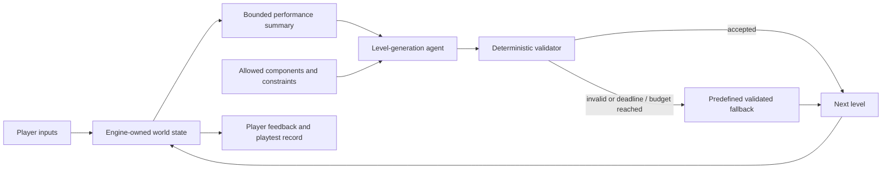

# Crown Chase — Initial Game Design Document

Status: **Initial / G1 proposal**, version 0.2, prepared November 16, 2026. No implementation, playtest results, or gate approval is claimed.

Accountable Owner: Scarlett Leon, Design Lead, retaining Creative Director and Executive Producer responsibility. Gate Approver: instructor.

## 1. Sources and document lifecycle

Requirements come from the local course reader, version 2.1 (November 10, 2026), especially Section 5.2 and the G1–G3 playbooks. The primary design source is Scarlett's 13-slide proposal, locally named `docs/Crown_Chase.pdf` (the request called it `Crown Chase.pdf`). Slide references below refer to that file. The reader is private course-reference material and is excluded from Git; its contents are not reproduced here.

Companion documents: [Initial Configuration](INITIAL_CONFIGURATION.md) and [Initial Project Plan](INITIAL_PROJECT_PLAN.md). This GDD and the Configuration Document become **Update at G2/G3** and **Final at G4**. Proposed details beyond the slides require Scarlett's review. Open decisions have stable IDs; the Project Plan collects the complete question list.

## 2. Game overview, player, and intended experience

**The X:** Crown Chase is a 2D fantasy platformer where players guide a princess through dangerous worlds, defeating enemies and overcoming obstacles to reclaim her magical crown from an evil witch. (Slide 2.)

**Genre:** Classic 2D platformer with performance-adaptive level generation. **Platform:** [OPEN D1] Target operating systems, distribution format, and supported input devices are undecided. Godot is proposed, not implemented.

**Target player:** Players who enjoy classic 2D platformers such as Super Mario. Their intended motivations are exploring fantasy worlds, overcoming challenges, collecting power-ups, improving platforming skills, and progressing toward the crown. Intended evidence of success is voluntary retries after losing and a desire to continue progressing; these are hypotheses, not observations. (Slide 3.)

**Story and setting:** An evil witch has stolen the princess's magical crown. The princess travels through dangerous magical environments, confronting enemies associated with the witch and her coven. The broader fantasy supports different worlds; this prototype contains only one playable world. A complete storyline and ending are excluded. (Slides 2, 5, 10.)

**Intended aesthetics:** Fantasy adventure, growing mastery, and satisfying progress through fair challenges. Visuals should make the princess, platforms, enemies, hazards, and power-ups readable. [OPEN D2] Art style, world theme, minimum narrative presentation, sound cues, accessibility settings, and asset pipeline remain to be selected. No asset production or reuse is claimed.

## 3. Design pillars

1. **Satisfying Platforming:** Responsive movement, challenging but fair obstacles, and rewarding progression.
2. **Adaptive Challenges:** AI-generated layouts respond to performance, changing difficulty and combinations of enemies and obstacles.
3. **Fantasy Adventure:** A princess protagonist, magical environments, and enemies tied to the witch's coven.

These are priorities for review: layout variety should preserve movement fairness, and fantasy presentation must fit the one-world scope. (Slide 5.)

## 4. Core loop and valid play session

| Stage | Player and game behavior |
|---|---|
| Act | Move left/right, jump across platforms and obstacles, stomp enemies, collect power-ups. |
| Respond | Enemies move independently according to their behaviors; obstacles demand timing; damage may remove power-ups. |
| Interpret | Learn movement patterns, identify safer routes, and revise strategy from previous attempts. |
| Next action | Retry after losing, or advance after completion to another challenge, potentially generated by the agent. |

A planned session starts with an eligible fixed or validated generated level, lets the player exercise this loop, records completion/failure and performance, and offers retry or progression subject to lives. Generation happens between gameplay sessions rather than during active platforming. [OPEN D3] Define whether a “session” is a level attempt, a sequence of levels, or a whole play visit, and whether retry preserves the layout; the budget accounting unit must be explicit before implementation. (Slides 4, 8, 11.)

### Controls and authoritative rules

- Move left/right and jump are player inputs. Stomping results from platforming/collision behavior; collecting a power-up is an interaction with the world, not necessarily a separate button.
- Restart after failure is supported conceptually. [OPEN D1] Exact key bindings, controller support, pause/menu controls, and remapping are undecided.
- The engine owns player movement, physics, collision, damage, and life changes. The agent cannot control the princess or change these rules.
- Enemies move independently. The player can defeat enemies by stomping. Obstacles require timing and precision. [OPEN D4] Enemy roster, behavior patterns, stomp eligibility, obstacle catalog, and damage interactions are undecided.
- Taking damage may remove power-ups. Losing a level costs one life; losing all lives produces **Game Over**. [OPEN D5] Starting lives, health units, power-up effects/duration, invulnerability, death triggers, and reset behavior are undecided. (Slides 4, 8.)

### Progression, scoring, balance, and edge cases

Completing a level advances the player to another challenge. Reclaiming the crown is the overarching narrative goal, not a promised completed prototype ending. [OPEN D6] Define level completion triggers, number/length of levels, prototype success/end screen, and any checkpoints. No scoring system is specified; decide whether to omit points or define a score. (Slides 4, 10.)

**Intended dynamics:** Repeated attempts teach timing, routes, and enemy patterns; adaptive layouts should respond to performance without feeling arbitrary. [OPEN D7] Define difficulty bands and how deaths, retries, and completion influence them. Do not equate more deaths with a need for harder levels.

Proposed edge-case checks for review: simultaneous completion and fatal damage; repeated damage in one frame; missing/overlapping spawn; impossible jump; loss of final life; restart during transition; service failure; and a late model response after fallback. [OPEN D5/D6] Gameplay priority/reset rules require decisions. Invalid generation must never change physics to make a layout pass.

**Feedback:** Proposed minimum feedback is readable movement/collision, damage and power-up changes, life count, completion/failure, retry/Game Over, and a transition/loading indication. [OPEN D2] Exact UI, audio, animation, and accessibility choices remain undecided. Balance and responsiveness require testing, not assertions of fairness.

## 5. In-game AI level-generation agent

The agent receives a bounded summary: deaths, retries, completion results, and allowed difficulty constraints. It may propose layouts and select predefined platforms, enemies, and obstacles, adapting challenge within approved bounds. It has no unrestricted game-state access. It cannot control the princess, override physics, alter collision/damage rules, or introduce arbitrary code/assets. (Slides 8–9.)

The engine deterministically checks allowed components, safe spawn, basic layout constraints, and traversability under the actual movement rules. Rejected layouts may be regenerated within a limited budget or replaced with a predefined fallback. [OPEN C3/C4] Data format, validation algorithm, movement model, and regeneration count are not decided. A geometric reachability test alone does not establish enjoyable or fair enemy timing.

Configuration, permissions, failure handling, logging, and budgets are specified in [Initial Configuration](INITIAL_CONFIGURATION.md). This in-game agent is separate from proposed development assistants.

## 6. Hypothesis, baseline, and evaluation

**Hypothesis:** AI-generated levels that adapt to player performance will produce more appropriately challenging gameplay and encourage players to continue playing compared with fixed levels. (Slide 9.)

**Scripted baseline:** A predetermined sequence of levels with fixed enemy/obstacle placements and no adjustment based on performance. Without the agent, players lose personalized difficulty adjustment, layouts responding to recent performance, and some challenge variation.

**Primary playtest question:** Do players find adaptive AI-generated levels more enjoyable and appropriately challenging than fixed levels?

**Proposed metrics:** Level completion rate, number of retries, player-rated difficulty, player-rated enjoyment, and willingness to continue. Observe voluntary retries separately from required retries. Record deaths and generation/fallback performance as supporting evidence.

Proposed comparison: use the same movement rules, component catalog, and one-world content for both conditions; record condition order and build/configuration. [OPEN E1] Participant recruitment, consent, sample size, rating scales, ordering/counterbalancing, equal exposure, completion-rate denominator, and decision criteria need approval. A small G2 observation cannot establish causal or population-wide benefit; novelty and procedural variation may confound the adaptation claim.

Plan at least one external core-loop playtest for the combined G2/G3 review. Preserve question, consent and anonymous participant ID, build/configuration, procedure, observations, interpretation/uncertainty, change, verification, and remaining questions. For agents, preserve deterministic checks and bounded live runs, including failures, invalid proposals, latency, cost, and traces. Later requirements include at least two distinct external players across G2–G4, a revised encounter tested between G2/G3 and G4 with a finding linked to a change, and an external release playtest after Alpha and before the Gold recording. No evaluation has occurred in the inspected repository.

## 7. Prototype scope and alternatives

**Included:** One playable fantasy world; basic movement/jumping; simple enemies and obstacles; power-ups and lives; AI-generated layouts; deterministic validation and fallback; fixed-level baseline; basic playtest tracking. (Slide 10.)

**Excluded:** Multiple completed worlds, complex boss battles, multiplayer, extensive inventory, full narrative campaign/storyline and ending, and large numbers of enemy types.

**Cut first:** Additional enemy varieties, extra obstacles, and decorative content, as specified on slide 10. Preserve core platforming and the agent-versus-baseline evaluation. Any material reduction of an approved commitment requires instructor review.

**Alternatives:** A Doom-like first-person shooter and a 2D fighting game. Crown Chase won because platformers are a personal favorite and were judged a good opportunity for incorporating an AI agent. This is a concept-selection judgment, not demonstrated technical ease. (Slide 6.)

## 8. References, attribution, and feasibility

**Super Mario Bros. — Nintendo:** Design inspiration for movement, jumping, stomping, power-ups, and level progression. Crown Chase changes the protagonist, setting, story, enemies, and level-generation system. No Nintendo code or assets are planned for reuse. (Slide 7.)

**SuperTux Classic:** A previously explored technical reference, supplied in the project brief rather than the presentation. No code or assets are assumed reused. [OPEN R1] If reuse is proposed, identify the exact files/version, applicable code/asset licenses, attribution and redistribution obligations, and obtain Scarlett's approval before copying. No license has been adopted from that project.

**Godot:** Proposed engine per the brief; no existing Godot implementation was found. Engine version and language remain undecided.

Feasibility budgets from slide 11: **2–3 seconds target**, **5 seconds maximum wait** with fallback; **less than $0.01 target model cost/session**, **$0.05 maximum**, approximately **6 requests/session**, preliminary **$0.0036/session**. None has been validated. The brief proposes treating six as a maximum; retry accounting needs an explicit configuration. Gemini 2.5 Flash-Lite, the original slide choice, retired on October 20, 2026. Google Cloud Vertex AI remains the proposed platform, with **Gemini 3.5 Flash-Lite as the proposed replacement**, not configured, tested, or approved. The original $0.0036 estimate is not a verified Gemini 3.5 Flash-Lite estimate. Configuration Section 7 documents official sources and a separate revised estimate of $0.0186/session under standard global pricing and the same token/request assumptions; this exceeds the unchanged target but is below the maximum. [OPEN C2] Approval, project/region access, settings, and measured latency/cost remain unresolved. The six original risk ratings and slide evidence are retained in the Project Plan.

## 9. Open design decisions and source review

Design questions: D1 platform/inputs; D2 presentation/accessibility; D3 session/retry semantics; D4 enemy/obstacle catalog; D5 health/lives/power-ups and damage/reset rules; D6 progression/scoring/completion and edge-case priority; D7 adaptation policy. Related questions: C2 model availability, C3 data format, C4 validator, E1 evaluation, R1 reuse. The complete register is in the Project Plan.

Source reconciliation: the broad story's multiple worlds coexist with a one-world prototype; the prototype explicitly excludes the full ending. The slide's first-cut list includes extra obstacles as well as enemy varieties and decoration, retained here. No story, pillar, hypothesis, baseline, scope, budget, or original risk rating was changed. New technical and evaluation details are proposals for review, not completed work. The model lifecycle conflict is addressed by explicitly proposing Gemini 3.5 Flash-Lite in place of the retired original model; implementation approval and configuration remain [OPEN C2].
